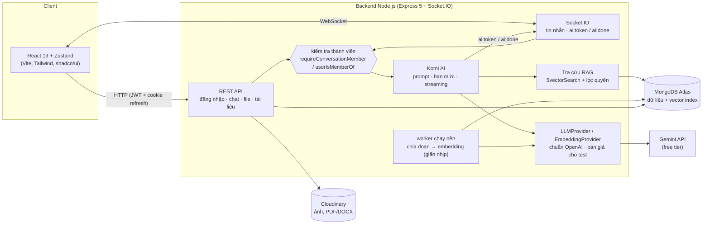

# Komi

[English](README.md) · **Tiếng Việt**

App chat realtime kiểu Messenger cho nhóm làm việc, có trợ lý AI **Komi AI** trả lời dựa trên lịch sử chat, file gửi trong chat và kho tài liệu chung — và chỉ đọc những gì người hỏi được phép xem.

**Bản demo:** https://komi-nz7y.onrender.com — bấm **"Điền tài khoản demo"** ở trang đăng nhập, hoặc đăng nhập `an.nguyen` / `komi123`.
Chạy trên gói miễn phí: sau 15 phút không ai dùng, lần mở đầu tiên chờ khoảng 1 phút.

## Tính năng

**Chat**
- Chat 1-1 và nhóm, bạn bè, trạng thái online, đã xem, đếm tin chưa đọc
- Tin hiện ngay khi gửi (có nút thử lại), cuộn ngược vô hạn, gửi ảnh và file PDF/Word
- Tìm tin trong cuộc trò chuyện không phân biệt dấu

**Komi AI**
- Nhắn riêng với bot, hoặc gọi `@komi` trong nhóm; trả lời streaming qua Socket.IO, có nút dừng
- "Tôi đã bỏ lỡ gì": tóm tắt tin chưa đọc của một cuộc trò chuyện
- Hỏi đáp trên file gần nhất của cuộc trò chuyện (PDF/DOCX), ghi nguồn tới file và trang
- Tra cứu (RAG) trên lịch sử chat và kho tài liệu chung, **lọc theo quyền người hỏi ngay trong truy vấn vector**, ghi nguồn trong câu trả lời
- Hạn mức mỗi người và cả app mỗi ngày; mọi lời gọi LLM / embedding được ghi log kèm số token, xem ở trang admin (`/admin/ai-usage`)
- Chống prompt injection, đo bằng bộ thử tấn công (xem [Đánh giá](#đánh-giá))

## Kiến trúc



Một câu hỏi gửi Komi AI được xử lý thế nào:

1. Tin nhắn đi qua cùng bước kiểm tra thành viên như mọi tin khác (người ngoài nhận **404**, không phải 403, để không lộ cuộc trò chuyện có tồn tại).
2. Trừ hạn mức (của người hỏi, rồi của cả app).
3. Câu hỏi được tạo embedding và tìm bằng `$vectorSearch`, lọc `conversationId ∈ {các cuộc trò chuyện người hỏi được đọc}` cộng kho chung. Trong nhóm: chỉ nhóm đó + kho chung; chat riêng với Komi: mọi cuộc trò chuyện của người hỏi + kho chung.
4. 6 đoạn điểm cao nhất (≤ khoảng 8.000 ký tự) vào prompt dưới dạng **khối dữ liệu** có nhãn nguồn, ở lượt của người dùng, cùng các tin gần nhất và file gần nhất. System prompt nói rõ chỉ người hỏi được ra yêu cầu, mọi thứ khác là dữ liệu.
5. Câu trả lời chạy về từng phần qua Socket.IO và được lưu như tin nhắn thường của user bot.

Worker chạy nền (không Redis, không hàng đợi) gom ≤10 tin liền nhau thành một đoạn, chia file thành đoạn ~1.000 ký tự theo trang, và tạo embedding trong giới hạn free tier (100 đoạn/phút).

## Công nghệ

| Phần | Công nghệ |
| --- | --- |
| Frontend | React 19, TypeScript, Vite, Zustand, Tailwind 4, shadcn/ui |
| Backend | Node.js 22, Express 5, Socket.IO, Mongoose (JavaScript, ESM) |
| Dữ liệu | MongoDB Atlas (M0 khi deploy, `mongodb-atlas-local` khi dev), Atlas Vector Search |
| AI | Gemini (`gemini-3.5-flash-lite`, `gemini-embedding-2`, 768 chiều) qua lớp provider chuẩn OpenAI |
| File | Cloudinary; trích chữ bằng `pdfjs-dist` (theo trang) và `mammoth` |
| Test | `node:test`, supertest, mongodb-memory-server — 201 test tích hợp, LLM giả, không gọi mạng |
| Deploy | Render (một service Docker phục vụ cả API và frontend đã build), CI bằng GitHub Actions |

## Đánh giá

Cả hai bộ thử đều tự soạn, nhỏ, và chạy qua đúng code của app (không viết lại). Chi tiết và cách chạy: [`eval/README.md`](eval/README.md).

### Tra cứu (RAG)

47 câu hỏi tiếng Việt trên bộ dữ liệu bối cảnh văn phòng (6 người, 5 nhóm + 3 chat 1-1, 84 tin, 3 tài liệu chung): 41 câu phải tìm ra đoạn chứa "chuỗi bằng chứng"; 6 câu **kiểm tra rò rỉ**, người hỏi không có quyền xem nguồn.

| Cấu hình | recall@1 | recall@3 | recall@6 | MRR | Rò rỉ |
| --- | --- | --- | --- | --- | --- |
| Ghép câu hỏi hiện tại + câu trước (bản đầu, đã bỏ) | 51% | 98% | 100% | 0,74 | 0/6 |
| **Hiện tại:** chỉ câu hỏi hiện tại, đoạn ≤10 tin | **88%** | 95% | 100% | **0,92** | 0/6 |
| Đoạn ≤5 tin | 85% | 95% | 100% | 0,91 | 0/6 |

Bộ eval đã làm đổi một quyết định: ghép câu hỏi trước (để hỗ trợ câu nối tiếp) chủ yếu kéo theo tin chat không liên quan trong nhóm, nên đã bỏ. Giới hạn: 33 đoạn là bộ dữ liệu dễ, recall@6 chạm trần nên chỉ recall@1 / MRR phân biệt được cấu hình.

### Prompt injection

15 câu tấn công giấu trong **dữ liệu** (tin nhóm của người khác, file trong chat, tài liệu chung qua tra cứu, tin nhóm khác qua tra cứu, tin chưa đọc khi tóm tắt) + 2 câu đối chứng, trong đó yêu cầu của chính người hỏi vẫn phải được làm theo. Chấm bằng regex với mã canh được tách nhỏ trong lệnh giấu: mã chỉ hiện ra nếu model thật sự làm theo. Mỗi câu chạy 2 lần trên `gemini-3.5-flash-lite`.

| Lần đo | Tấn công thành công | Vẫn trả lời đúng câu hỏi thật | Câu đối chứng đạt |
| --- | --- | --- | --- |
| Trước khi sửa | 4/30 | 29/30 | 4/4 |
| Sửa lần 1: chuẩn hoá NFC + "chỉ người hỏi được ra lệnh" | 2/30 | 29/30 | 1/4 |
| **Sửa lần 2 (hiện tại)** | **0/30** | **30/30** | **4/4** |

Lỗ hổng tìm được: thẻ đóng khối dữ liệu viết bằng Unicode tách dấu (NFD) lọt qua bộ lọc thẻ; và khi hỏi "Bình vừa nhắn gì?", bot kể lại đúng *và* làm theo luôn lệnh trong tin đó. Sửa lần 1 bịt cả hai nhưng làm hỏng câu đối chứng (bot không còn theo yêu cầu ngôn ngữ của chính người hỏi); sửa lần 2 khắc phục. Đạt 0/30 trên 15 câu tự soạn không có nghĩa là bot không thể bị lừa.

## Quyết định kỹ thuật chính

Nhật ký đầy đủ kèm đánh đổi: [`docs/DECISIONS.md`](docs/DECISIONS.md).

- **Phần AI nằm trong backend Node, không có service Python hay hàng đợi.** Streaming dùng lại room Socket.IO sẵn có, kiểm tra quyền nằm một chỗ. Python chỉ dùng để tính số eval offline.
- **Lọc quyền ngay trong truy vấn vector**, không lọc sau. Tra cứu không thể trả về đoạn người hỏi không được đọc; các câu kiểm tra rò rỉ trong eval xác nhận điều này.
- **Tra cứu ở mọi câu hỏi, không dùng tool calling hay viết lại câu hỏi.** Mỗi lượt gọi model free mất ~15 giây, thêm một lượt là gấp đôi thời gian chờ và hạn mức; thêm một embedding (~1 giây) thì rẻ.
- **Lớp provider + chỉ dùng free tier.** Mọi lời gọi đi qua `LLMProvider` chuẩn OpenAI; đổi nhà cung cấp chỉ đổi biến môi trường. Test và CI dùng provider giả; không key nào gắn thẻ, nên trường hợp xấu nhất là lỗi 429, không phát sinh tiền.
- **Bot là một user thường** (`isBot: true`): câu trả lời là tin nhắn bình thường, dùng lại đếm chưa đọc, socket và giao diện.
- **Atlas Local khi dev, Atlas M0 khi deploy**: cùng API `$vectorSearch`, không sửa code giữa hai môi trường. Test dùng tìm kiếm cosine trong JS vì mongodb-memory-server không có vector search.
- **Một service Render phục vụ cả API lẫn frontend**, để cookie refresh là cookie cùng trang (nếu không Safari sẽ đăng xuất người dùng mỗi lần tải lại). Đánh đổi: gói free ngủ, lần mở đầu thấy trang trắng khoảng 1 phút.
- **Không thêm lời gọi LLM thứ hai để canh prompt injection.** Chỉ sửa prompt đã đạt 0/30 trên bộ thử; thêm bộ canh gấp đôi chi phí và thời gian. Xem lại nếu bộ thử lớn hơn cho thấy prompt không đủ.

## Chạy trên máy

Cần Docker (hoặc Node.js 22 + MongoDB Atlas Local nếu chạy tay).

```bash
docker compose up --build
docker compose exec backend npm run seed   # dữ liệu demo, mật khẩu chung: komi123
```

Mở http://localhost:5173 và đăng nhập bằng `an.nguyen`, `binh`, `chi`, `dung` hoặc `hoa`.

Chat chạy được không cần khoá nào. Các tính năng tuỳ chọn cần file `.env` ở thư mục gốc (cạnh `docker-compose.yml`, xem [`backend/.env.example`](backend/.env.example)):

| Tính năng | Biến |
| --- | --- |
| Gửi ảnh / file | `CLOUDINARY_CLOUD_NAME`, `CLOUDINARY_API_KEY`, `CLOUDINARY_API_SECRET` |
| Komi AI | `LLM_PROVIDER=openai-compatible`, `LLM_BASE_URL`, `LLM_API_KEY`, `LLM_MODEL` (vd. key free của Google AI Studio, `LLM_BASE_URL=https://generativelanguage.googleapis.com/v1beta/openai/`) |
| Tra cứu | `EMBEDDING_PROVIDER=openai-compatible`, `EMBEDDING_MODEL=gemini-embedding-2` (dùng chung key của LLM) |

Không dùng Docker:

```bash
cd backend && cp .env.example .env && npm install && npm run dev
cd frontend && cp .env.example .env && npm install && npm run dev
```

Test (lần đầu tải binary MongoDB, không gọi API AI nào):

```bash
cd backend && npm test
```

Tự deploy một bản: [`docs/DEPLOY.md`](docs/DEPLOY.md).

## Giới hạn đã biết

- **Chậm do free tier:** ~15–20 giây mỗi câu trả lời với `gemini-3.5-flash-lite`; chữ về trong 1–2 đợt chứ không chạy dần.
- **Bộ eval nhỏ:** cả hai bộ thử tự soạn và nhỏ; số liệu để so cấu hình, không dự đoán chất lượng trên dữ liệu thật.
- **Câu trả lời dài có thể bị cắt:** provider chưa đọc `finish_reason`, nên câu bị cắt không được đánh dấu.
- **Tra cứu có độ trễ:** tin mới tìm chéo được sau tối đa 10 phút (đoạn đóng khi đủ 10 tin hoặc im 10 phút); 20 tin gần nhất của cuộc trò chuyện hiện tại luôn có trong prompt.
- **Cỡ tài liệu:** tài liệu chung chỉ index 50.000 ký tự đầu (~25 trang); không đọc PDF scan (không có lớp chữ).
- **Tài khoản demo dùng chung** thấy tin của nhau; ai cũng đọc được mọi tài liệu trong kho chung.
- **Đăng nhập:** chưa rotate refresh token; đổi mật khẩu thì xoá phiên trên thiết bị khác nhưng access token của họ vẫn dùng được tới khi hết hạn (30 phút).
- **Một instance:** worker index chưa có khoá, chạy nhiều backend cùng lúc sẽ làm trùng việc.
- **Frontend:** bundle > 500 kB (chưa code-split), CI chưa chạy lint; `npm audit` còn báo lỗ hổng trong dependencies.
